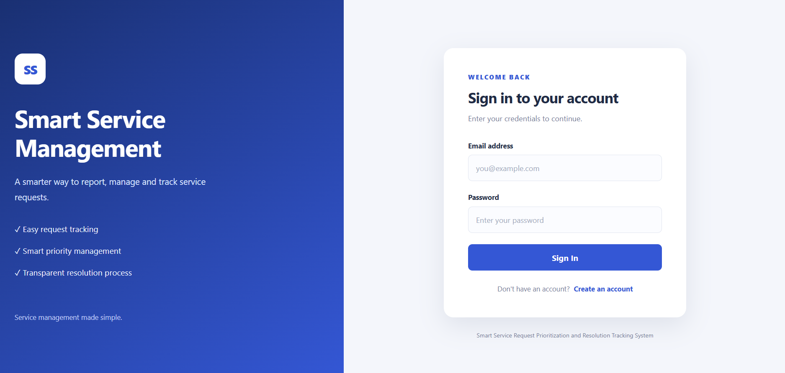
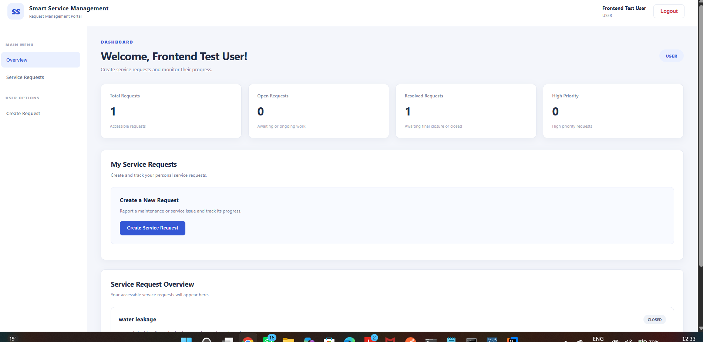
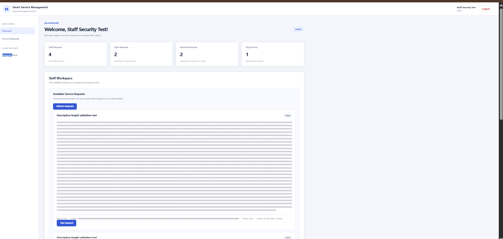
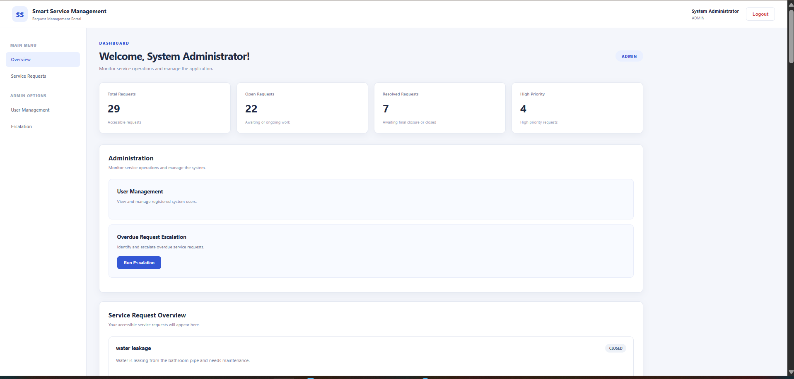
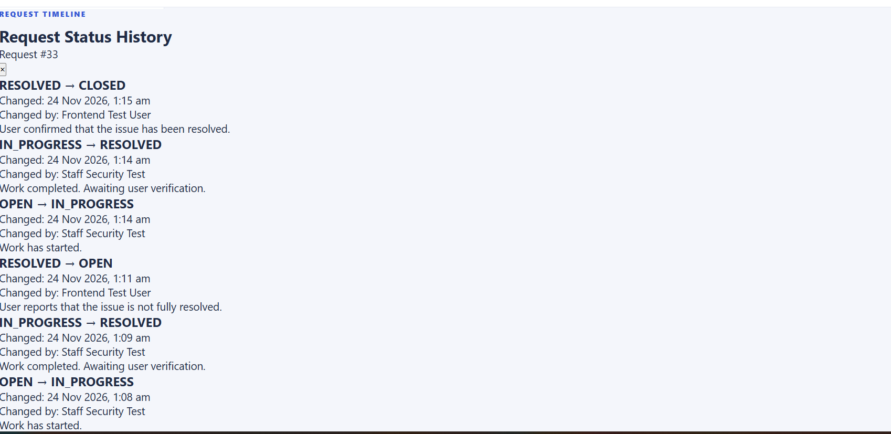

# Smart Service Request Prioritization and Resolution Tracking System

A Java-based service management application that helps organizations manage service requests, prioritize issues, assign staff, track resolutions, and escalate overdue requests.

## Project Overview

Traditional complaint management systems often lack effective prioritization, recurring issue detection, accountability, and proper resolution verification.

This project addresses these challenges through a centralized REST API with role-based access control, rule-based priority calculation, and structured request management workflows.

A key feature is **resolution verification**: when staff marks a request as resolved, the original requester must verify the resolution before the request can be closed. If the issue persists, the requester can reopen it.

## Key Features

- User registration and login with BCrypt password hashing.
- JWT-based authentication and authorization.
- Role-based access for USER, STAFF, and ADMIN.
- Service request creation, retrieval, and tracking.
- Automatic rule-based priority calculation (LOW, MEDIUM, HIGH).
- Recurring issue detection based on category and location.
- Staff assignment and assignment-based access control.
- Request status tracking with a detailed status history.
- Resolution verification by the original requester.
- Request reopening when an issue remains unresolved.
- Automatic escalation of overdue requests.
- Ownership validation to prevent unauthorized access.
- Input validation and inactive-account access prevention.
- Responsive web interface for interacting with the application.

## Technology Stack

| Component | Technology |
|---|---|
| Programming Language | Java 17 |
| Backend Framework | Spring Boot |
| Database | MySQL 8 |
| Database Access | Spring JDBC (JdbcTemplate) |
| Security | Spring Security |
| Authentication | JSON Web Token (JWT) |
| Password Security | BCrypt |
| Frontend | HTML5, CSS3, JavaScript |
| API Testing | Postman |
| Build Tool | Maven |
| IDE | IntelliJ IDEA |

## Application Architecture

The application follows a layered backend architecture:

1. **Controller Layer** – Handles incoming REST API requests and responses.
2. **Service Layer** – Implements business logic, priority calculation, validation, and workflow management.
3. **Repository Layer** – Uses JdbcTemplate to interact with the MySQL database.
4. **Security Layer** – Handles JWT authentication, authorization, and role-based access.
5. **Database Layer** – Stores users, service requests, assignments, and status history.
6. **Frontend Layer** – Provides login, registration, dashboards, and request management interfaces.

## Application Roles

### USER

- Register and log in.
- Create service requests.
- View personal service requests.
- Track request progress.
- Verify completed requests.
- Close or reopen resolved requests.

### STAFF

- Log in securely.
- View available and assigned requests.
- Take available requests.
- Update assigned request statuses.
- Mark requests as resolved.

### ADMIN

- View users and service requests.
- Access administrative user-management operations.
- Trigger overdue request escalation.
- Access the administrative database testing endpoint.

## Priority Management

Requests are prioritized using rule-based business logic.

| Priority | Example Conditions | Escalation Threshold |
|---|---|---|
| HIGH | Electrical hazards, fire, gas leaks | 2 hours |
| MEDIUM | Water leakage, internet issues, broken facilities | 24 hours |
| LOW | General service issues | 48 hours |

Recurring issues can increase request priority based on matching requests within the defined time window.

## Resolution Workflow

1. A user creates a service request.
2. The system calculates its priority.
3. Staff takes or handles the request.
4. Staff marks the request as RESOLVED.
5. The original requester verifies the resolution.
6. The requester closes the request if the issue is fixed.
7. If the issue persists, the requester can reopen it.
8. Overdue requests are escalated according to their priority thresholds.

## Automatic Escalation

The system identifies overdue requests using priority-based time thresholds:

- HIGH: 2 hours.
- MEDIUM: 24 hours.
- LOW: 48 hours.

The scheduled escalation process checks for overdue requests every 5 minutes and escalates eligible requests.

Administrators can also trigger escalation through the administrative API.

Escalation events are recorded in request status history.

## Security

- JWT-based stateless authentication.
- BCrypt password hashing.
- Role-based endpoint protection.
- Request ownership validation.
- Staff assignment validation.
- Inactive account access prevention.
- Database-backed user-role verification.
- Database credentials supplied through environment variables.
- JWT signing secret supplied through an environment variable.

## Database

**Database name:** `smart_service_db`

Main database tables:

- `users`
- `request_categories`
- `service_requests`
- `request_assignments`
- `request_status_history`

The database stores user information, service requests, staff assignments, and request status transitions.

## Running the Project

### Prerequisites

- Java 17
- MySQL 8
- Maven
- IntelliJ IDEA or another Java IDE

### 1. Clone the Repository

```bash
git clone https://github.com/Siddharth-267/smart-service-management-backend.git
```

Open the cloned project in your IDE.

### 2. Create the Database

Run the following SQL command in MySQL:

```sql
CREATE DATABASE smart_service_db;
```

Ensure the required database tables are created according to the project database schema.

### 3. Configure Environment Variables

Configure the database connection in `application.properties`.

Set the following environment variables:

- `DB_PASSWORD` – MySQL database password.
- `JWT_SECRET` – Securely generated Base64-encoded JWT signing secret.

Do not commit database passwords, JWT secrets, or other credentials to GitHub.

### 4. Build and Run

Make sure MySQL is running and the required database configuration is correct.

Build the project using Maven:

```bash
mvn clean install
```

Alternatively, use the Maven wrapper:

**Windows:**

```bash
mvnw.cmd clean install
```

**Run the application:**

```bash
mvn spring-boot:run
```

Or run the main application class:

`SmartServiceManagementApplication.java`

### 5. Open the Application

Once the application starts, open:

http://localhost:8080

The frontend is served by the Spring Boot application.

## API Documentation

**Base URL:**

`http://localhost:8080`

Detailed endpoint information, request formats, authentication requirements, and response examples are documented in:

`API_DOCUMENTATION.md`

Protected endpoints require a valid JWT access token.

## Testing

The application was tested using Postman and browser-based frontend testing.

Key test scenarios include:

- User registration and login.
- JWT authentication and unauthorized API access.
- Role-based access restrictions.
- Service request creation and retrieval.
- Invalid input and category validation.
- Staff assignment and request ownership validation.
- Prevention of unauthorized staff updates.
- Prevention of users accessing other users' requests.
- Request history access restrictions.
- Complete request resolution and reopening workflow.
- Administrative escalation.
- History display with actual user names.
- Responsive dashboard layout.


## Screenshots

### Login and Registration


### User Dashboard


### Staff Dashboard


### Admin Dashboard


### Request Status History

## Project Purpose

This project was developed to demonstrate practical Java backend development, REST API design, database integration, authentication, authorization, and business workflow automation.

It focuses on improving service request accountability through priority-based handling, staff assignment, request ownership validation, resolution verification, and overdue escalation.

The project demonstrates how a structured Spring Boot backend can support a practical service management application.demonstrates Java backend development, REST API design, Spring Boot application development, JDBC database integration, authentication, authorization, business-rule implementation, input validation, and automated workflow management.